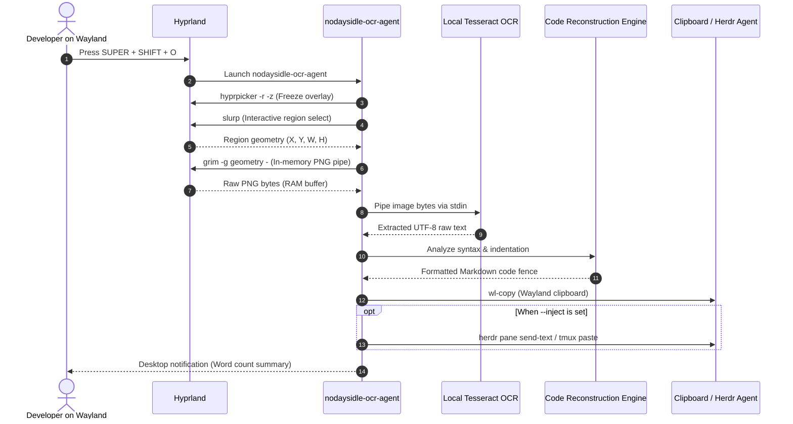

# nodaysidle-ocr-agent

Fast Wayland screen-region OCR and markdown code context injector for AI coding agents (Claude Code, Antigravity / AGY, Codex, Hermes, Pi) and terminal multiplexers (Herdr, Tmux).

---

## Overview

When developing alongside autonomous AI coding agents, developers frequently encounter code snippets, compiler errors, API documentation, or diagrams trapped in non-selectable interfaces:
- Video tutorials and conference recordings
- Web browser canvas elements and documentation graphics
- Virtual machine consoles and VNC/RDP sessions
- IDE popups, tooltip overlays, and debugger inspector windows

Sending full-screen image captures to an LLM wastes thousands of vision tokens, introduces image compression artifacts, and clutters the conversation context. Conversely, manually transcribing code is slow and error-prone.

`nodaysidle-ocr-agent` solves this with a lightweight Wayland pipeline:
1. Press `SUPER + SHIFT + O` on any workspace.
2. Drag a crosshair box across any screen region.
3. The pixels are captured in RAM and processed locally via OCR in under 40 milliseconds.
4. Code structures and compiler diagnostics are automatically detected, normalized, and wrapped in clean Markdown code fences (` ```rust `, ` ```python `, ` ```bash `).
5. The formatted text is placed directly onto your Wayland clipboard (`wl-copy`), ready to paste anywhere with `Ctrl+V`.

---

## Architecture Flow



---

## Key Features

- **Zero Disk I/O:** The entire capture-to-OCR pipeline executes entirely in system RAM via piped standard streams (`hyprpicker` freeze overlay $\rightarrow$ `slurp` crosshairs $\rightarrow$ `grim` pixel stream $\rightarrow$ `tesseract` memory buffers). No temporary files touch the disk.
- **Smart Syntax Reconstruction:**
  - **Language Detection:** Recognizes syntax patterns for Rust, Python, TypeScript/JavaScript, Bash/Shell, JSON, and TOML.
  - **Compiler Diagnostic Detection:** Identifies Rust `error[E...]` diagnostics, Python tracebacks, and panic dumps, wrapping them in formatted diagnostic blocks.
  - **Whitespace & Indentation Normalization:** Cleans up OCR artifacts, preserves indentation depth, and trims trailing line noise.
- **Clipboard-First Safety:** Puts clean Markdown directly into `wl-copy`. It will never auto-paste into your active terminal unless explicitly requested.
- **Optional Direct Agent Dispatch (`--inject`):** Can probe running terminal multiplexers ([Herdr](https://github.com/nodaysidle/herdr) or [Tmux](https://github.com/tmux/tmux)) and dispatch context into the active agent pane without shifting desktop workspaces or losing focus.
- **Zero Key Conflicts:** Designed specifically for Hyprland on Arch / Omarchy Linux, bound cleanly to `SUPER + SHIFT + O` without conflicting with system keys.

---

## Installation

### Prerequisites (Arch Linux / Omarchy)

Install the required Wayland capture and OCR tools:

```bash
sudo pacman -S grim slurp hyprpicker tesseract tesseract-data-eng wl-clipboard
```

### Build from Source

Ensure you have Rust and Cargo installed:

```bash
git clone https://github.com/nodaysidle/nodaysidle-ocr-agent.git
cd nodaysidle-ocr-agent
cargo build --release
cp target/release/nodaysidle-ocr-agent ~/.local/bin/
cp target/release/way-ocr-agent ~/.local/bin/
```

Verify the installation:

```bash
nodaysidle-ocr-agent --help
```

---

## Compositor Configuration (Hyprland)

Add the following binding to your `~/.config/hypr/bindings.lua` (or `hyprland.conf`):

```lua
-- Wayland Fast Screen-Region OCR and Code Context Injector for AI coding agents
o.bind("SUPER + SHIFT + O", "Agent OCR Context Injector", "/home/arch/.local/bin/nodaysidle-ocr-agent")
```

Reload Hyprland:

```bash
hyprctl reload
```

---

## Command-Line Usage

```text
Fast Wayland Screen-Region OCR and Code Context Injector for AI coding agents and Herdr

Usage: nodaysidle-ocr-agent [OPTIONS]

Options:
  -l, --lang <LANG>  Language code for Tesseract (defaults to eng) [default: eng]
      --raw          Disable Markdown code fence detection and output raw extracted text
  -i, --inject       Automatically inject formatted text into active agent pane (Herdr/Tmux) instead of clipboard only
  -s, --stdout       Print extracted markdown to stdout
  -h, --help         Print help
  -V, --version      Print version
```

### Examples

#### Standard Region Crop to Clipboard
```bash
nodaysidle-ocr-agent
```
Prompts for selection, copies formatted markdown to clipboard, and sends a desktop notification.

#### Print Markdown Directly to Terminal / Pipe
```bash
nodaysidle-ocr-agent --stdout
```
Useful for shell scripting or piping directly into CLI commands:
```bash
nodaysidle-ocr-agent --stdout | agy
```

#### Auto-Dispatch into Background Agent Pane
```bash
nodaysidle-ocr-agent --inject
```
Identifies the active agent pane in Herdr or Tmux and injects the extracted code block directly into the agent's input stream.

---

## Automated Test Suite

Run the built-in regression and syntax recognition tests:

```bash
cargo test
```

Expected output:
```text
running 4 tests
test test_detect_compiler_error ... ok
test test_detect_json ... ok
test test_detect_plain_prose ... ok
test test_detect_rust_code ... ok

test result: ok. 4 passed; 0 failed; 0 ignored; 0 measured; 0 filtered out; finished in 0.00s
```

---

## License

MIT License. Copyright (c) 2026 nodaysidle.
